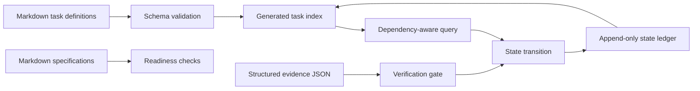

# Architecture

## Goal

Agentic Build Kit isolates deterministic workflow decisions from any model or automation provider. A model may propose work and an external CI system may produce evidence, but this kit decides whether a task is structurally valid, ready to start, and eligible for completion.

## Data flow

## Components

### Frontmatter parser

`scripts/lib/frontmatter.mjs` implements the deliberately small YAML subset used by task files: scalars, inline arrays, block arrays, and one-level nested objects. Other YAML features are not interpreted; the task schema still validates every field used by the workflow.

### Task core

`scripts/lib/task-core.mjs` owns the schema, task loading, state folding, indexing, scheduling, readiness checks, evidence validation, and ledger writes. CLI files are thin adapters around this module.

### Immutable definitions and append-only state

Task Markdown remains reviewable input. Each transition is appended as one JSON object to `loop/.state.jsonl`. Folding the ledger over task definitions produces current state. This keeps the audit trail visible and avoids rewriting task descriptions.

### Scheduling

The scheduler opens the earliest milestone with unfinished work, excludes tasks with incomplete dependencies, ranks by priority, then prefers the task that unlocks the largest transitive dependency chain. Stable ID ordering resolves ties.

### Completion gate

Completion requires a project-local evidence file whose task ID matches and whose required checks all report `pass` with a non-empty evidence description. The gate reads data only; it never evaluates shell commands from tasks or evidence.

## Trust model

The tool assumes the project directory and its task/spec files are trusted local input. Evidence content is a contract, not cryptographic proof. Multi-process ledger writes and evidence authenticity are outside this reference implementation's scope.
