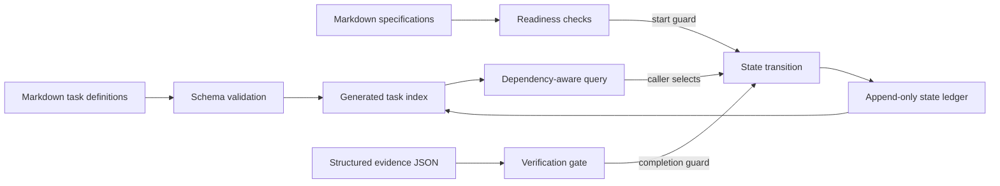

# Architecture

## Goal

Agentic Build Kit is a local Task & Evidence CLI. It separates deterministic task bookkeeping from external execution: a developer, model or CI system performs work and supplies reports, while the CLI validates task definitions, checks dependencies, reports structural readiness and records state changes.

There are no model, CI, GitHub, Sentry or email adapters in the current implementation. Provider routing, code generation, test execution, review execution, pull requests and automatic merging belong to an integrating workflow.

## Data flow

## Components

### Frontmatter parser

`scripts/lib/frontmatter.mjs` implements the deliberately small YAML subset used by task files: scalars, inline arrays, block arrays, and one-level nested objects. Other YAML features are not interpreted; the task schema still validates every field used by the workflow.

### Task core

`scripts/lib/task-core.mjs` owns the schema, task loading, state folding, indexing, scheduling, readiness checks, evidence validation, and ledger writes. CLI files are thin adapters around this module.

### Immutable definitions and append-only state

Task Markdown remains reviewable input. Each transition is appended as one JSON object to `loop/.state.jsonl`. Folding the ledger over task definitions produces current state. This keeps the audit trail visible and avoids rewriting task descriptions.

### Scheduling

The scheduler opens the earliest milestone with unfinished work, excludes pending tasks with incomplete dependencies, ranks by priority, then prefers the task that unlocks the largest transitive dependency chain. Stable ID ordering resolves ties. Blocked tasks require an explicit restart; they are not automatically selected as pending work.

`spec-readiness.mjs` checks required foundation files, module presence, declared project-local Markdown specification references, recognised unresolved markers, ADR status markers, recorded open decisions and task integrity. It is available as a separate diagnostic command and is enforced by start transitions. Task selection considers dependencies and scheduling; selection alone does not establish specification readiness. The readiness check does not establish semantic completeness of a specification.

### Completion gate

Completion requires a project-local JSON report whose task ID matches, whose timestamp parses, and whose tests, static analysis and review entries each report `pass` with descriptive evidence text. The gate reads data only; it never executes the reported commands or checks their external results. A failed completion attempt leaves the current state unchanged; recording `blocked` is a separate explicit transition.

## Trust model

The tool assumes the project directory and its task/spec files are trusted local input. Evidence content is a local assertion, not authenticated proof or a result bound to a Git commit. Completed events are revalidated against their referenced report during replay; removing or changing that report can invalidate the replayed project. Definitions, reports and journal files remain editable by the local user.

Multi-process ledger writes, evidence authenticity, commit binding and independently enforced production approval are outside this reference implementation's scope. The journal uses append operations for normal transitions; this is not tamper-proof storage.
